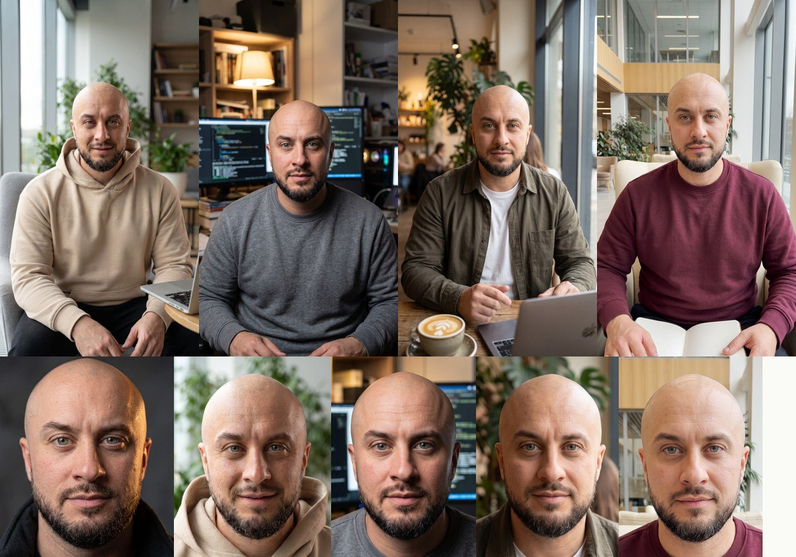
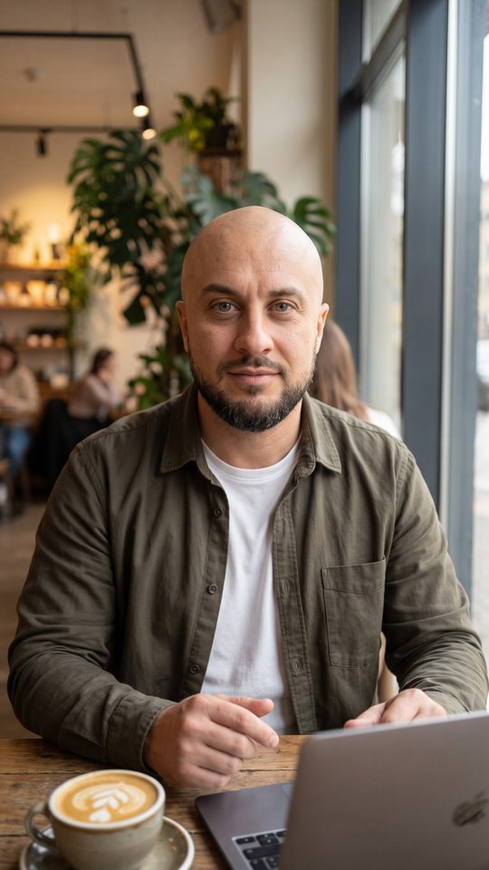
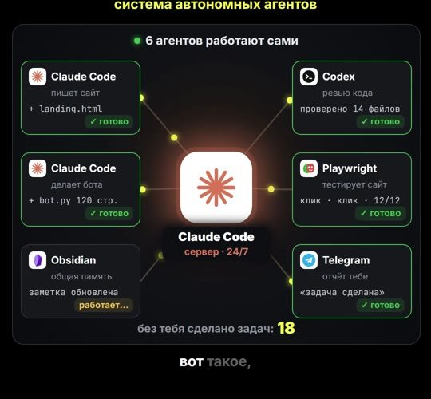

# Эталон 07: ролик с живым аватаром

Файлы, которыми собран ролик «7 инструментов вокруг Claude Code» (86 с). Порядок работы и объяснения — в `docs/etalon-avatar.md`.

| Файл | Что это |
|---|---|
| `storyboard.md` | Раскадровка: 39 кадров секунда в секунду по оригиналу. Её человек утверждает до начала видео |
| `prompts/look_template.txt` | Задание генератору картинок на кадр образа: лицо по вашим фото, место, свет, крупность. Свои черты вписать вместо `<…>` |
| `prompts/omni_clip.txt` | Задание видео-аватару на один говорящий клип |
| `prompts/broll_hands.txt`, `broll_laptop.txt` | Перебивки без лица в том же месте |
| `scripts/omni_spec.example.json` | Все 10 реплик ролика как задания на клипы: длительности и тексты фонетикой |
| `scripts/clips_to_film.py` | Склейка клипов в один говорящий фильм и звуковую дорожку |
| `scripts/avatar_track.py` | Видеоряд человека по раскладкам: весь кадр, крупно ×1,2, низ поделённого кадра 1:1, перебивки |
| `scripts/align_words.py` | Перенос времён нового голоса на старые номера слов, чтобы не переделывать графику |
| `scripts/build_film.py` | Сборщик сцен и субтитров по словам голоса (HyperFrames) |
| `tpl/s01.html`, `s02.html` | Хук-сравнение: обычный чат против системы автономных агентов |
| `tpl/s03.html`, `s05.html` | «7 инструментов» и плашка приложения поверх человека |
| `tpl/kit.css`, `lib.js`, `icons.js`, `captions.html`, `fonts.css` | Общий стиль, помощники анимации, иконки, субтитры, шрифты |

Шрифты в репозиторий не положены: `fonts.css` ждёт Inter, JetBrains Mono и Playfair Display в `assets/fonts/` (возьмите на Fontsource). Нужен `gsap.min.js` в `assets/`.

## Как это выглядит

Четыре образа на выбор: сверху кадры, снизу слева исходное фото лица и рядом лица каждого варианта крупно. Автор выбрал третий, «кафе».

Кадр образа, по которому сделаны все говорящие клипы, и хук «система автономных агентов»:

 

Готовый ролик лежит в релизе репозитория, ссылка в `examples/README.md`. Свой кадр образа каждый делает по своим фото.
