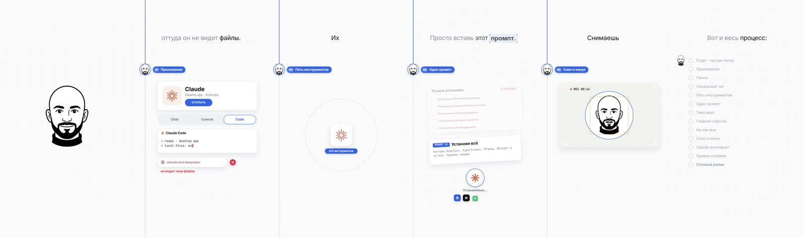
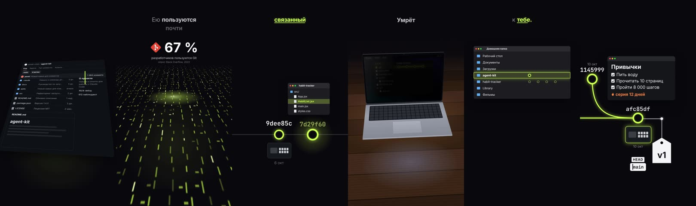
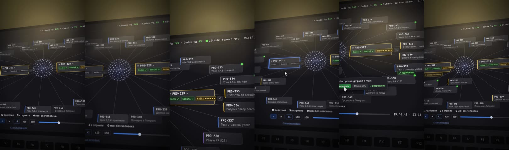
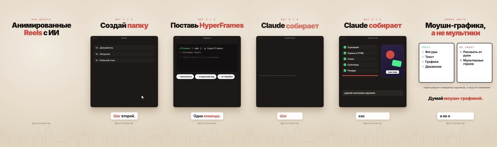
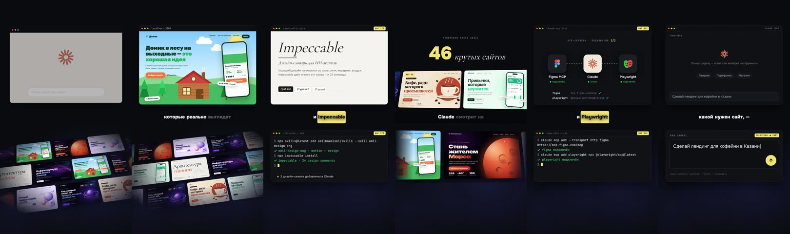
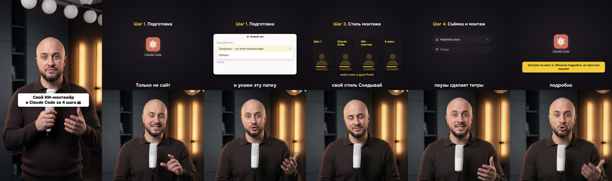
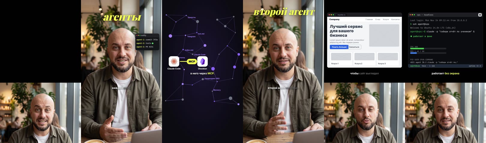
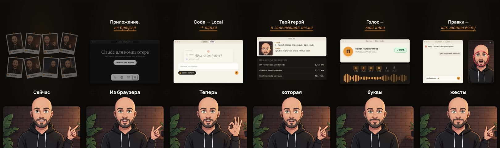
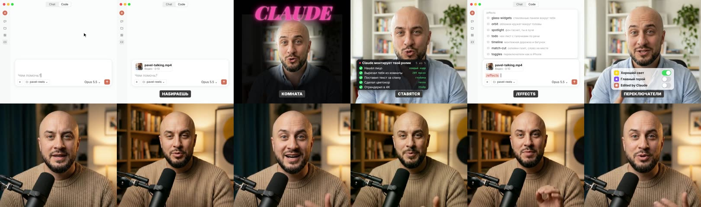

# 9 эталонов: чем и как собран каждый ролик

Все девять ремейков собраны этим скиллом в ноябре 2026. В каждой папке лежит разбор оригинала (`analysis.json`) и оба сценария. Ниже рецепт каждого: тип кадра, инструменты, приём и главная грабля. Цифры взяты из отчётов о сборке; стоимость указана примерно и без подписки ElevenLabs.

У каждого ролика ниже лента из шести кадров и ссылка на готовое видео (720p, файлы релиза `etalons-2026-11`).

Общее для всех: голос — клон в ElevenLabs с таймингами слов, графика и субтитры кодом в HyperFrames / OpenMotion с привязкой к словам голоса, приёмка листами кадров каждые 0,5 с и моделью Gemini со звуком, громкость −14 LUFS, рендер бесплатный.

| № | Оригинал | Тип кадра | Длина | Примерная стоимость |
|---|---|---|---|---|
| 01 | mrcreates.ai | нарисованный персонаж + графика | 92,7 с | меньше 100 ₽ |
| 02 | jesserurka | только графика | 61,4 с | около 0 ₽ |
| 03 | paha_kotov | съёмка экрана «с рук», без лица | 34,6 с | 5–10 ₽ |
| 04 | aiminutes1 | только графика | 59,4 с | около 30 ₽ |
| 05 | mahadmateen.ai | только графика | 31,2 с | 10–20 ₽ |
| 06 | potapovfx | поделённый кадр: графика + живой человек | 102,4 с | около 220 ₽ |
| 07 | aantoinelee | поделённый кадр + живой человек | 86,1 с | около 300 ₽ |
| 08 | tony.shev.ai | поделённый кадр: графика + нарисованный персонаж | 74,7 с | 15–20 ₽ |
| 09 | david_knowsai | поделённый кадр: экран + живой человек | 46,9 с | около 120 ₽ |

## 01 · нарисованный персонаж на весь кадр

[Смотреть ролик 01 (MP4)](https://github.com/PavelDumbrao/viral-reel-remake-kit/releases/download/etalons-2026-11/01_mrcreates.ai.mp4)
- **Чем собран:** Nano Banana рисует чёрно-белую голову по фото и стилю оригинала (база, 4 варианта рта, моргание). Свой скрипт на Python двигает рот и глаза по таймингам слов. 18 сцен и титры — HyperFrames.
- **Приём:** сцены, титры и рот персонажа привязаны к одним и тем же таймингам слов готового голоса.
- **Грабля:** русский текст той же структуры вышел на 10 с длиннее. Помогло ускорение голоса на 5 % с пересчётом таймингов; ужимать паузы бесполезно, у ElevenLabs их почти нет.

## 02 · только графика

[Смотреть ролик 02 (MP4)](https://github.com/PavelDumbrao/viral-reel-remake-kit/releases/download/etalons-2026-11/02_jesserurka.mp4)
- **Чем собран:** макеты окна Claude Code, Finder, GitHub и графа коммитов нарисованы кодом в одном стиле, 11 сцен.
- **Приём:** верхняя строка с подсветкой слов идёт в такт голосу, ключевые слова выделены цветом и подчёркиванием.
- **Грабля:** первый текст звучал 72 с при оригинале 55 с. Сценарий дважды сократили и ускорили голос на 5 %. Один и тот же текст в разных дублях даёт разные ударения, поэтому делали 3 дубля и выбирали по проверке.

## 03 · съёмка экрана «с рук»

[Смотреть ролик 03 (MP4)](https://github.com/PavelDumbrao/viral-reel-remake-kit/releases/download/etalons-2026-11/03_paha_kotov.mp4)
- **Чем собран:** экран ноутбука и «камера телефона» нарисованы кодом: камера ведётся по 15 ключам, привязанным к словам, есть дрожание руки, блик и шум. Палец заменён курсором с кольцом клика.
- **Приём:** эффект съёмки с рук сделан кодом, без видеогенератора.
- **Грабля:** при наезде камеры длинные подписи на экране уходили за край кадра. Помогли 2–3 короткие строки у центра фокуса и проверка снимками на каждом плане.

## 04 · только графика, шаги

[Смотреть ролик 04 (MP4)](https://github.com/PavelDumbrao/viral-reel-remake-kit/releases/download/etalons-2026-11/04_aiminutes1.mp4)
- **Чем собран:** сцены кодом, стиль снят с полного кадра оригинала (палитра, шрифт, плашка «ШАГ N / 5»). В хуке три карточки-телефона с живыми видео своих прошлых роликов.
- **Приём:** субтитры по одному слову с цветными ключевыми словами; в хук поставлены свои настоящие ролики.
- **Грабля:** два дубля по-разному прочитали название сервиса. Дубль выбирали по расшифровке и проверке моделью, а не первый по порядку.

## 05 · только графика, сайты-примеры

[Смотреть ролик 05 (MP4)](https://github.com/PavelDumbrao/viral-reel-remake-kit/releases/download/etalons-2026-11/05_mahadmateen.ai.mp4)
- **Чем собран:** 12 сцен; 9 своих лендингов сверстаны кодом и сняты браузером без окна. Финал отрендерен кусками в облаке.
- **Приём:** вместо чужих скриншотов показаны свои лендинги; это вышло лучше, чем генерация картинок.
- **Грабля:** русский хук в 1,5–1,7 раза длиннее английского, а параметр скорости у ElevenLabs не работает. Помогло ускорение звука на 8 % с пересчётом таймингов.

## 06 · поделённый кадр с живым человеком

[Смотреть ролик 06 (MP4)](https://github.com/PavelDumbrao/viral-reel-remake-kit/releases/download/etalons-2026-11/06_potapovfx.mp4)
- **Чем собран:** кадр образа — Nano Banana; говорящие клипы — видео-аватар Omni (фото первым кадром, речь начинается сразу); голос — speech-to-speech в свой клон одним проходом по всей дорожке; графика шагов сверху — HyperFrames.
- **Приём:** геометрия сплита повторяет оригинал; аватар сам говорит каждую реплику, поверх ничего не накладывается.
- **Грабля:** аватар говорит медленнее оригинала (около 2,2 слова в секунду против 3,1). Склейку ускорили в 1,12 раза вместе со звуком, синхрон губ сохранился.
- **Ремонт голоса** готового ролика без перегенерации видео описан в `docs/lessons.md`.

## 07 · живой человек в кадре, эталон аватара

[Смотреть ролик 07 (MP4)](https://github.com/PavelDumbrao/viral-reel-remake-kit/releases/download/etalons-2026-11/07_aantoinelee.mp4)
- **Чем собран:** раскадровка до видео, образ на выбор из четырёх, 11 говорящих клипов Omni 1.2 по одному кадру образа, speech-to-speech и выравнивание тембра каждого блока, графика HyperFrames.
- **Приём:** крупное лицо в кадре, дневной свет, родная мимика аватара без наложений; хук-сравнение «обычный чат против системы агентов».
- **Грабля:** три версии подряд автор не принял («это не я»). Помогло сменить порядок работы и прописать черты лица словами.
- **Полностью:** `docs/etalon-avatar.md`, файлы — `07_aantoinelee/etalon/`.

## 08 · нарисованный персонаж в нижней части кадра

[Смотреть ролик 08 (MP4)](https://github.com/PavelDumbrao/viral-reel-remake-kit/releases/download/etalons-2026-11/08_tony.shev.ai.mp4)
- **Чем собран:** Nano Banana — база, 5 поз рук, 9 ртов, моргание (19 картинок). Свои скрипты режут картинку на слои, двигают рот по буквам речи и добавляют моргание и кивки. Это перекладка картинок, а не видеогенератор.
- **Приём:** персонаж двигается по буквам голоса, позы меняются на ударных словах; синхрон губ сверен лентой кадров рта.
- **Грабля:** таблица звуков знала только кириллицу, и рот замирал на английских словах. Добавили латинские буквы.

## 09 · экран сверху, живой человек снизу

[Смотреть ролик 09 (MP4)](https://github.com/PavelDumbrao/viral-reel-remake-kit/releases/download/etalons-2026-11/09_david_knowsai.mp4)
- **Чем собран:** 13 клипов видео-аватара Omni, по одной реплике на клип; ключевые кадры — Nano Banana, два ракурса чередуются; голос — speech-to-speech; сверху окно с командами и 7 эффектов кодом.
- **Приём:** резы камеры стоят по речи: каждая реплика — отдельный клип.
- **Грабля:** к концу картинка отставала от звука на 0,3 с, потому что каждый кусок отдельно переводили в 30 кадров в секунду. Границы кусков выровняли по родным кадрам (24 к/с), а в 30 к/с перевели весь ролик один раз в конце.
